# labview-grpc-bridge-example

Example project demonstrating bidirectional gRPC communication between a LabVIEW DQMH module and a Python WebUI client.

https://github.com/user-attachments/assets/924c781a-f0f0-4a75-9505-95288ac31e6f

## Set up

### Python Environment

Create and activate a virtual environment (recommended), then install the required Python packages:

```bash
pip install nicegui==3.7.1 grpcio==1.78.0 grpcio-tools==1.78.0
```
### LabVIEW Environment

Install the following packages via **VIPM**:

- **Thermal Chamber Examples for DQMH** – v7.1.2.1546  
- **DQMH® Framework: Palette** – v7.1.2.1546 (dependency of the examples)

For the NI gRPC libraries and templates:

- **NI gRPC for LabVIEW v1.6.1.1 and Templates**

Follow the official installation instructions:  
https://github.com/ni/grpc-labview/blob/master/docs/QuickStart.md#labview-grpc

---

## Running the Demo

### 1. Start the LabVIEW gRPC Server

1. Open the LabVIEW project: `labview/gRPC Bridge.lvproj`

2. Run `thermal-chamber-controller_server/thermal-chamber-controller_server.lvlib/Run Server.vi`

The default parameters are:

- `Server Address = 127.0.0.1:50051`
- `Async [T] = True`

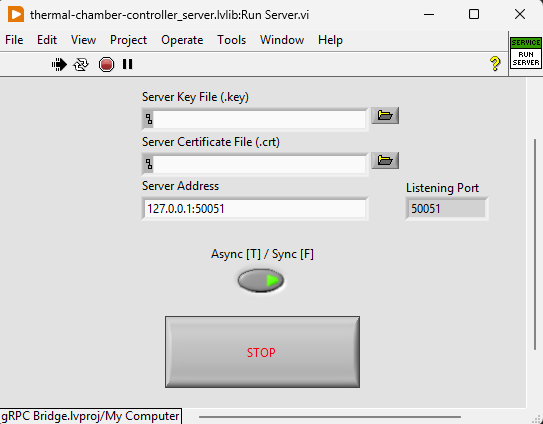

---

### 2. Start the Python WebUI

1. Activate your Python virtual environment (if used).

2. Run:
```bash
python python/webui/app.py
```
You should see the following console output:
```bash
NiceGUI ready to go on http://127.0.0.1:8081
```

3. A browser should open the following address automatically:
```bash
http://127.0.0.1:8081
```

The WebUI will automatically attempt to connect to the gRPC server.

## Architecture

The system consists of four logical layers:

1. DQMH Module (LabVIEW)
2. gRPC Server Layer (LabVIEW, auto-generated stubs + custom logic)
3. gRPC Client Layer (Python async bridge)
4. WebUI Layer (NiceGUI front-end)

The interaction flow is strictly layered:

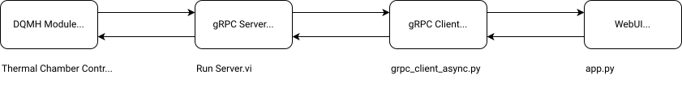

### Proto File

The basis for gRPC communication is the proto file. Since the goal of this demonstration is to control the DQMH Module *Thermal Chamber Controller_DQMH.lvlib* using gRPC, the best starting point to create a proto file are the relevant DQMH module requests:

| VI                         | Type      | Inputs       | Outputs        |
|----------------------------|-----------|--------------|----------------|
| Start Module.vi            | Request   | None         | None           |
| Stop Module.vi             | Request   | None         | None           |
| Show Panel.vi              | Request   | None         | None           |
| Hide Panel.vi              | Request   | None         | None           |
| Update Set Point.vi        | Request   | double       | None           |
| Update Ramp Rate.vi        | Request   | double       | None           |
| Update Heater State.vi     | Request   | Heater State | None           |
| Request Chamber Status.vi  | Request   | None         | None           |
| Set Point Updated.vi       | Broadcast | None         | double         |
| Ramp Rate Updated.vi       | Broadcast | None         | double         |
| Heater State Updated.vi    | Broadcast | None         | Heater State   |
| Chamber Status Updated.vi  | Broadcast | None         | Chamber Status |

`Heater State` is a type defined `ENUM`. Chamber Status represents a collection of doubles and a Heater State.

Based on the table above, the following common messages are defined in the proto file:

```
enum HeaterState {
  HEATER_ENABLED = 0;
  HEATER_DISABLED = 1;
}

message Empty {}
```

```HeaterState``` represents the corresponding type definition in the DQMH module. ```Empty``` is an empty message to be used when no inputs/outputs are present (Note: `google.protobuf.Empty` could be used instead).

Then messages are defined for all requests that specify data transfer: *Update Set Point.vi* and *Update Ramp Rate.vi* which have a double input and *Update Heater State.vi* which requires a ```HeaterState``` element.

```
message UpdateSetPointRequest {
  double temperature_set_point = 1;
}

message UpdateRampRateRequest {
  double temperature_ramp_rate = 1;
}

message UpdateHeaterStateRequest {
  HeaterState heater_state = 1;
}
```

For each request specified above there is a corresponding Broadcast with the same datatypes. Additionally, a message is defined for the *Chamber Status Updated.vi* broadcast:

```
message ChamberStatus {
  double actual_temperature = 1;
  double temperature_set_point = 2;
  double temperature_ramp_rate = 3;
  HeaterState heater_state = 4;
}
```

Finally, the service is defined mirroring the structure in the table:

```
service ThermalChamberController {
  // Mirrors DQMH Basic Requests  
  rpc StartModule(Empty) returns (Empty);
  rpc ShowModulePanel(Empty) returns (Empty);
  rpc HideModulePanel(Empty) returns (Empty);
  rpc StopModule(Empty) returns (Empty); 

  // Mirrors DQMH: Update Set Point (Request)
  rpc UpdateSetPoint(UpdateSetPointRequest) returns (Empty);

  // Mirrors DQMH: Update Ramp Rate (Request)
  rpc UpdateRampRate(UpdateRampRateRequest) returns (Empty);

  // Mirrors DQMH: Update Heater State (Request)
  rpc UpdateHeaterState(UpdateHeaterStateRequest) returns (Empty);

  // Mirrors DQMH Broadcasts (4 separate server-to-client streams)
  rpc SubscribeChamberStatusUpdated(Empty) returns (stream ChamberStatus);
  rpc SubscribeSetPointUpdated(Empty) returns (stream SetPointUpdated);
  rpc SubscribeRampRateUpdated(Empty) returns (stream RampRateUpdated);
  rpc SubscribeHeaterStateUpdated(Empty) returns (stream HeaterStateUpdated);
}
```

The result is [thermal_chamber_controller_dqmh.proto](proto/thermal_chamber_controller_dqmh.proto).

### LabVIEW: Async gRPC Server + DQMH Module
After creating an empty project, gRPC Server code is automatically generated using the code generator of grpc-labview (detailed instructions: https://github.com/ni/grpc-labview/blob/master/docs/BasicsTutorial.md#generating-client-and-server-code).

If the proto file changes the code will need to be recreated. This is safely done by deleting the automatically generated code completely, then running the code generator again. Because of this, most actions are implemented as SubVIs, so that they can be quickly reimplemented if needed.

This will create a virtual folder with the specified name (in my case `thermal-chamber-controller_server`) containing all relevant VIs.

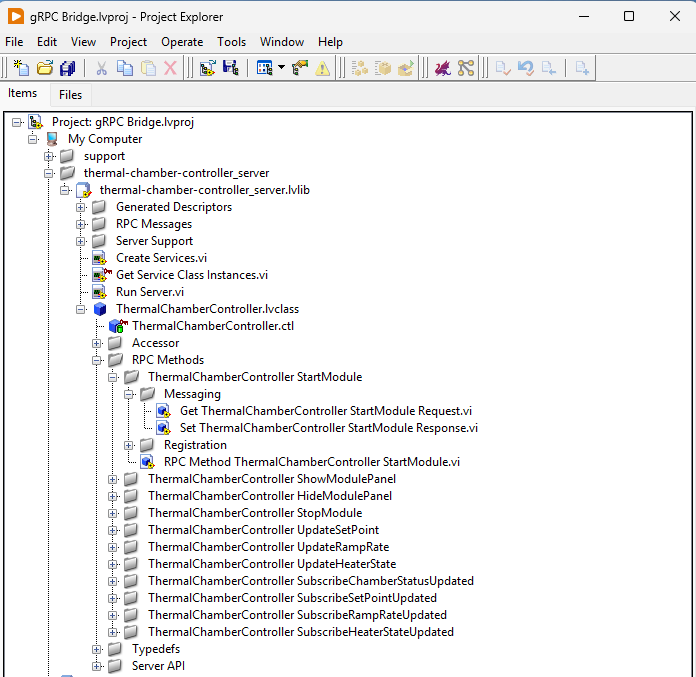

As you can see above, the class `ThermalChamberController.lvclass` mirrors the service in the proto file. Under `RPC Methods` a subfolder with relevant VIs is created for each rpc defined in the service.

The `RPC Method <Library> <Your-Method>.vi` is where the business logic is implemented. Input and Output parameters can be get/set respectively using the VIs in the virtual folder `Messaging`.

#### Requests

The business logic consists of:

1. Obtaining data from gRPC message (if needed)
2. Performing some action (e.g. send DQMH request)
3. Sending response.

Requests do not need to register the DQMH modules events because they usually do not require creating event cases for DQMH broadcasts. The exception is `StartModule`, which registers the DQMH events after starting the module.

Below are some examples of request implementations.

##### RPC Method ThermalChamberController StartModule.vi

DQMH module broadcast events are registered before entering the loop. This happens before starting the module. The actual event registration happens in the StartModule user event, after starting the module. After that, the events response is set.

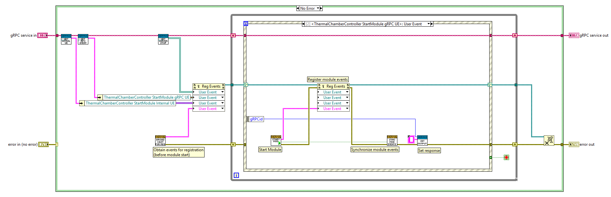

##### RPC Method ThermalChamberController UpdateHeaterState.vi

The data is obtained from the gRPC message using `Get ThermalChamberController UpdateHeaterState Request.vi`. The data type must be mapped to the DQMH type definition before sending the request to the DQMH module. Finally, the events response is set.

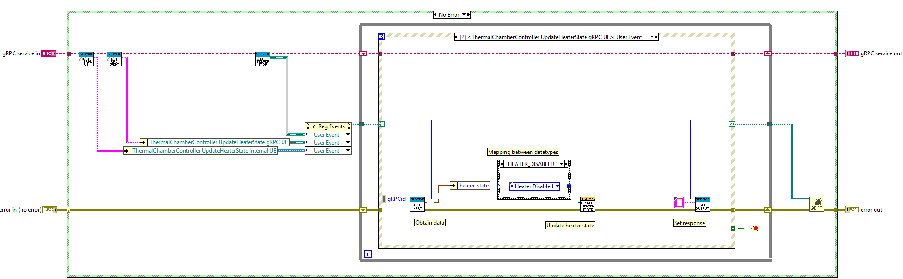

#### Broadcasts

As you can see in the proto file, the gRPC requests related to broadcasts are named "Subscribe...". The reason is that these requests actually start a continuous streaming process, triggered either periodically or by DQMH broadcast events. In order to implement this I identified the following parameters common to all broadcasts that are defined as `Stream Data--cluster.ctl`:

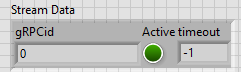

- `gRPCid` represents the message ID received through the gRPC method.
- `Active` indicates whether the stream has been initiated. This parameter can be used in the business logic to perform/avoid actions depending on whether the stream was subscribed.
- `timeout` is a period constant used to perform recurring tasks.

Broadcasts implement messaging using an event case for the corresponding DQMH module events. Because of this they need to register the DQMH module events.

The starting process for all broadcasts is implemented in `SubscribeAnyUpdated Start Stream.vi`. It comprises storing the `gRPCid` and the `timeout` in the shift register, setting `Active` to True, and registering the DQMH module broadcast events.

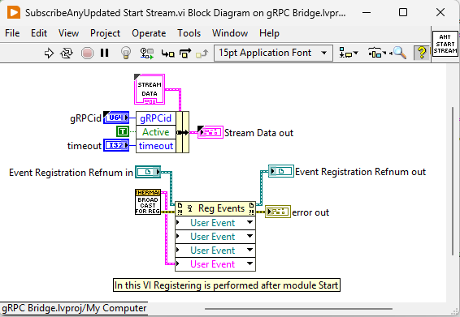

Below are some examples of broadcasts implementations.

##### RPC Method ThermalChamberController SubscribeSetPointUpdated.vi

The user event triggered by SubscribeSetPointUpdated is displayed below: this case uses `SubscribeAnyUpdated Start Stream.vi` to initialize streaming.

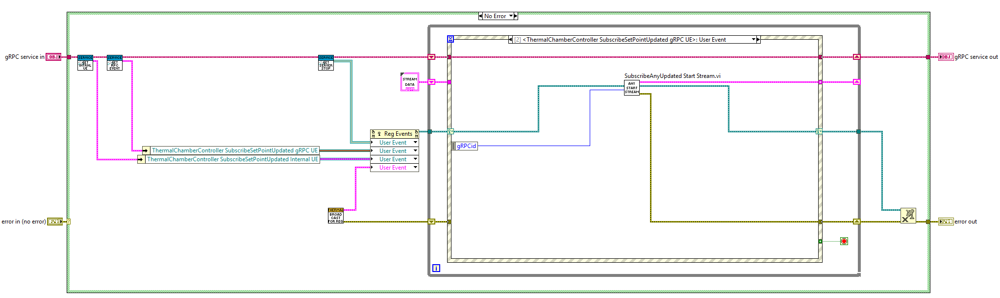

The event case for the DQMH Broadcast `Set Point Updated` is displayed below. If the Stream is active, the new set point is bundled into the output cluster and sent through gRPC. The Stream parameter signalizes the system that the stream is ongoing.

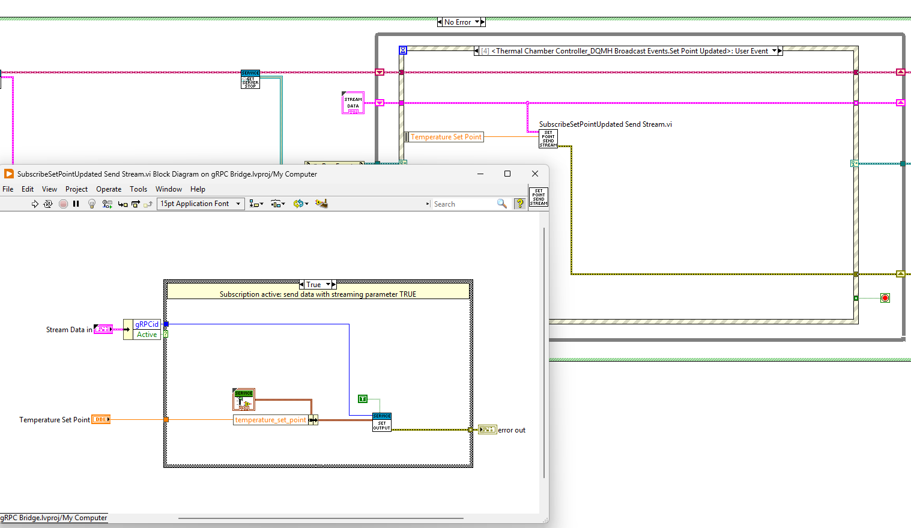

To stop the stream, a dummy message with "stream" False is sent. This action is performed when the DQMH module or the server stop.
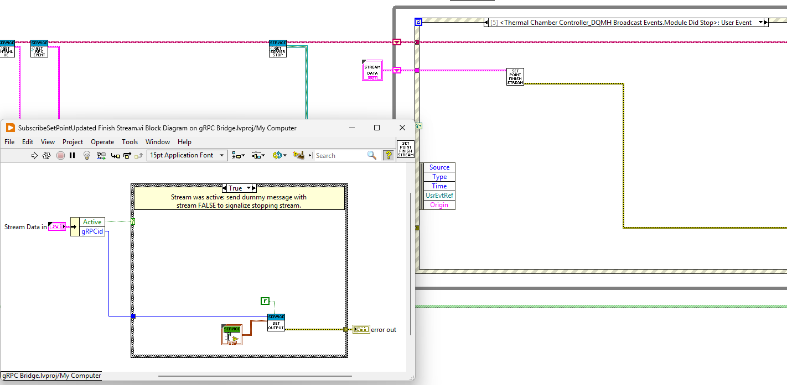

##### RPC Method ThermalChamberController SubscribeChamberStatusUpdated.vi

In this case periodic polling is implemented. For this a `timeout` is defined in the Subscribe event case and the value is used for the event structure timeout.

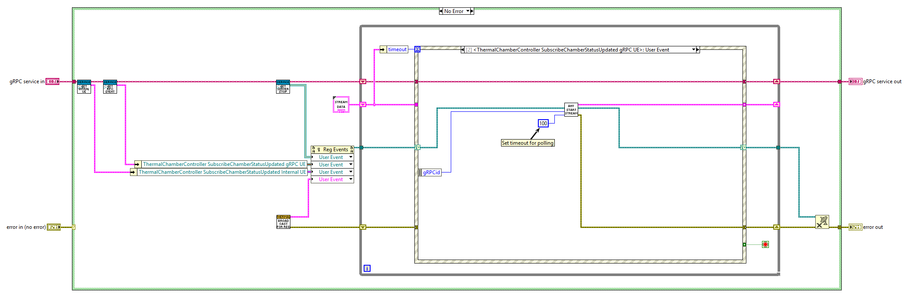

In the timeout case, the Request Chamber Status request is sent. The input "Wait for response" is set to false, so that the response can be handled asynchronously using the broadcast event.

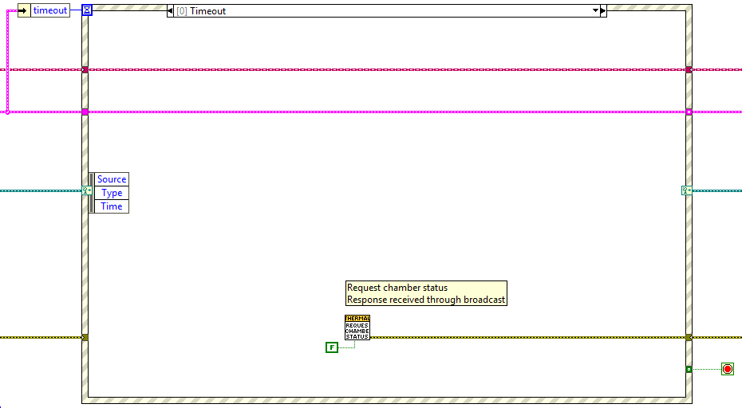

The image below shows the event case for the broadcast Chamber Status Updated: Values are bundled as the gRPC message response and sent. The stream parameter is set to true to signalize an ongoing stream.

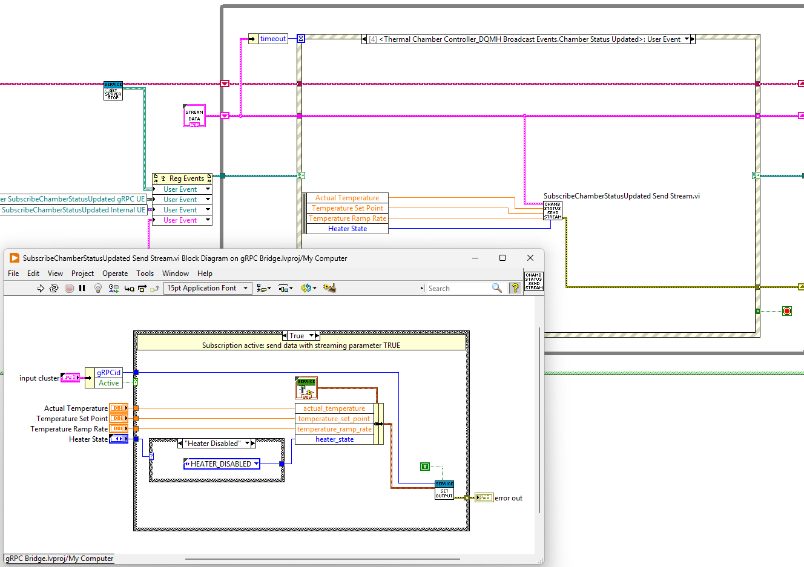

### Python: Async gRPC Client + NiceGUI WebUI

On the Python side, the project is split into two responsibilities:

- **`grpc_client_async.py`** implements an **async gRPC client bridge** with background stream listeners and a shared UI state.
- **`app.py`** implements the **NiceGUI front-end**, which renders the state and forwards user actions to the gRPC bridge.

This separation keeps UI code free of gRPC details and makes the client logic reusable outside of NiceGUI.

##### `grpc_client_async.py` (gRPC bridge)

The `GrpcBridgeAsync` class wraps the Python `grpc.aio` client and exposes a UI-friendly, service-specific API tailored to the `ThermalChamberController` service.

- Unary RPC helpers: `start_module`, `stop_module`, `show_panel`, `hide_panel`, `update_setpoint`, `update_ramprate`, `set_heater`
- Stream listeners are started **explicitly** via `start_listeners()` and run as background `asyncio.Task`s

`ChamberUiState` is the shared in-memory snapshot:

- actual temperature, set point, ramp rate, heater state
- `stream_ok` (set to True only by the status stream)

State reads/writes are protected by an `asyncio.Lock` to avoid race conditions.  
`snapshot()` returns a **copy** of the current state for safe UI consumption.

###### Connection handling: `connect_loop()`

The method `connect_loop()` runs as a long-lived background task:

1. Create an `grpc.aio.insecure_channel(target)` and stub (if not present)
2. Wait for `channel_ready()` with a timeout to mark the connection as healthy
3. While connected:
   - periodically check channel health (if `get_state()` is available)
   - mark the client disconnected and reset `stream_ok` if the channel leaves `READY`
4. On errors:
   - close/discard the channel and stub
   - sleep for a short retry delay
   - reconnect automatically

This makes the demo resilient against server restarts and transient failures.

###### Stream listeners: `start_listeners()`

Streams are started **explicitly** and only when needed (e.g. after the LabVIEW module has been started).
`start_listeners()` spawns one background task per server-to-client stream:

- `SubscribeChamberStatusUpdated` → updates all live values and sets `stream_ok=True`
- `SubscribeSetPointUpdated` → updates `temperature_set_point`
- `SubscribeRampRateUpdated` → updates `temperature_ramp_rate`
- `SubscribeHeaterStateUpdated` → updates `heater_state`

If any stream raises `grpc.aio.AioRpcError`, the bridge triggers a reconnect and clears `stream_ok`.

Stopping the module cancels all listener tasks and clears the task list.

---

##### `app.py` (NiceGUI WebUI)

The NiceGUI app renders the bridge state and sends commands to the server.

Key concepts:

- **Single shared bridge instance** (`grpcb = GrpcBridgeAsync(TARGET)`)
- A background task starts `connect_loop()` once when the main page is first loaded (connect/reconnect runs independently of the UI)
- The UI updates are driven by a periodic timer (`ui.timer(...)`), which:
  1. calls `await grpcb.snapshot()`
  2. updates badges/labels/plot based on the returned state

###### UI state rendering

The UI shows:

- **Connection badge** based on `grpcb.is_connected`
- **Stream badge** based on `state.stream_ok`
- Live values (actual temperature, set point, ramp rate, heater state)
- A rolling chart (last 60 seconds) updated from streamed values

Controls are enabled/disabled depending on connectivity to prevent invalid operations while disconnected.

###### User actions → unary RPCs

Buttons and controls call the unary RPC wrappers asynchronously:

- Start/Stop → `grpcb.start_module()` / `grpcb.stop_module()`
- Show/Hide panel → `grpcb.show_panel()` / `grpcb.hide_panel()`
- Set point / ramp rate / heater toggle → `grpcb.update_setpoint(...)`, `grpcb.update_ramprate(...)`, `grpcb.set_heater(...)`

All calls are executed via `asyncio.create_task(...)` so the UI thread remains responsive.

## Third-Party Dependencies

This project is provided as **source code only** and does **not bundle** any third-party libraries.  
All dependencies must be installed separately by the user using the respective package managers (pip for Python, VIPM for LabVIEW).  
During installation, users accept the licenses of those third-party components directly from their original authors.

### Python

The Python WebUI and gRPC client are built on the following primary frameworks:

- **nicegui** (MIT License) - v3.7.1  
    https://github.com/zauberzeug/nicegui

- **grpcio** (Apache License 2.0) - v1.78.0  
    https://github.com/grpc/grpc  

- **grpcio-tools** (Apache License 2.0) - v1.78.0  
    https://github.com/grpc/grpc/tree/master/tools/distrib/python/grpcio_tools

- **protobuf** (BSD 3-Clause License) - 6.33.5  
    https://github.com/protocolbuffers/protobuf
  

All other Python packages used in this project are **transitive dependencies** of these frameworks.

### LabVIEW

The LabVIEW side of this project relies on the following components, which must be installed separately by the user:

- **Thermal Chamber Examples for DQMH** ([DQMH Software License Agreement](https://wiki.dqmh.org/dqmh/eula)) - v7.1.2.1546
    
    *DQMH 7.1.2*

    *Includes DQMH Consortium Tools for LabVIEW, © 2026 DQMH Consortium. All rights reserved.*

    *Built with LabVIEW, © 2026 National Instruments Corporation. All rights reserved.*

- **DQMH® Framework: Palette** ([DQMH Software License Agreement](https://wiki.dqmh.org/dqmh/eula)) - v7.1.2.1546 
    Required by Thermal Chamber Examples.

- **NI gRPC for LabVIEW Libraries and Templates** - v1.6.1.1  
    https://github.com/ni/grpc-labview  
    Licensed under the MIT License and installed via VIPM.

    **Note:** This package must be downloaded from  
    https://github.com/ni/grpc-labview/releases/tag/v1.6.1.1  
    Follow the installation instructions from the Quick Start guide:  
    https://github.com/ni/grpc-labview/blob/master/docs/QuickStart.md#labview-grpc

This repository does not redistribute any of the above LabVIEW libraries.

## Disclaimer

LabVIEW™ is a trademark of National Instruments Corporation.

This project is an independent, open-source tool and is not affiliated with, endorsed by, or sponsored by National Instruments Corporation.
