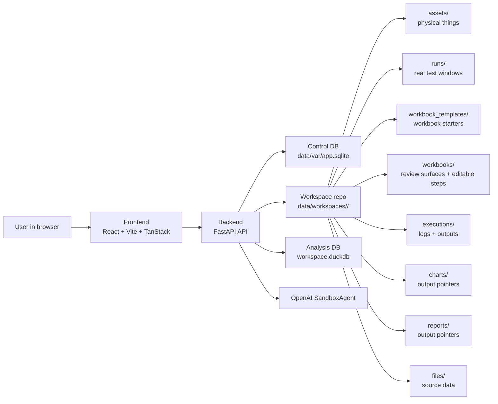
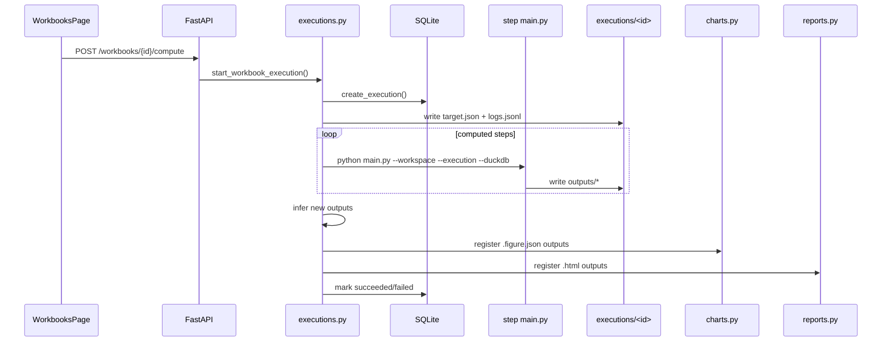

# Arc Architecture

Arc is a small local app with three big ideas:

1. The browser UI is the control panel.
2. The FastAPI backend is the control plane.
3. Each workspace folder is product data, versioned by its own git repo.

## Big Picture



## Product Model

```text
Asset
  physical thing, such as a headset, car, engine, or test stand

Run
  real-world test window for one asset
  has start/end time

Workbook Template
  reusable review starter

Workbook
  review surface for one asset, one run, or standalone data
  has Workbook Data attached for steps to inspect

Step
  one Python-backed workbook analysis section

Execution
  machine work that computes workbook steps
```

The normal chain is:

```text
Asset -> Run -> Workbook -> Steps -> Execution -> Outputs -> Charts/Reports/Checks
```

## Main Folders

```text
data/workspaces/<slug>/
  assets/<asset_id>/asset.json
  runs/<run_id>/run.json
  workbook_templates/
    workbook/<template_id>/
      template.json
      steps/<step_id>/
        step.json
        main.py
  workbooks/<workbook_id>/
    workbook.json
    steps/<step_id>/
      step.json
      main.py
  executions/<execution_id>/
    execution.json
    target.json
    logs.jsonl
    outputs/
  charts/<chart_id>/chart.json
  reports/<report_id>/report.json
  files/local/
  files/shared/
  workspace.duckdb
```

SQLite stores app/runtime state:

```text
users
workspaces
chats
messages
executions
```

Workspace git versions the user/project artifacts on disk.

## Workbook Data

Workbook Data is the set of files or datasets attached to one workbook. It keeps source data near the analysis that uses it, without forcing CSV, TDMS, JSON, and folder datasets into one strict shape too early.

Example:

```json
[
  {
    "id": "baseline-csv",
    "name": "Baseline CSV",
    "path": "files/local/baseline.csv",
    "kind": "file",
    "notes": ""
  }
]
```

At execution time, Arc writes these attached sources into `target.json`. Step scripts can inspect the workbook data list, read the source files directly, or use DuckDB hints when Arc can ingest the file.

## Workbook Execution



Charts and reports do not copy outputs. They point back to execution files:

```json
{
  "workbook_id": "run-review",
  "step_id": "signal-chart",
  "source": {
    "execution_id": "uuid",
    "output_path": "outputs/signal-chart.figure.json"
  }
}
```

## API Surface

Most behavior enters through `backend/app/api/routes.py`.

| Area | Endpoints | What they do |
| --- | --- | --- |
| Workspaces | `/api/workspaces` | List/create workspaces |
| Project | `/api/workspaces/{workspace_id}/project` | Workspace summary and visible tabs |
| Assets | `/api/workspaces/{workspace_id}/assets...` | Physical asset CRUD |
| Runs | `/api/workspaces/{workspace_id}/runs...` | Real-world test-run CRUD |
| Workbook templates | `/api/workspaces/{workspace_id}/workbook-templates...` | Reusable workbook starters |
| Workbooks | `/api/workspaces/{workspace_id}/workbooks...` | Review surfaces and compute |
| Executions | `/api/workspaces/{workspace_id}/executions...` | Logs and output browsing |
| Files | `/api/workspaces/{workspace_id}/files...` | Upload, preview, and page source data |
| DuckDB | `/api/workspaces/{workspace_id}/duckdb/query` | Read-only analysis queries |
| Charts | `/api/workspaces/{workspace_id}/charts` | Chart output pointers |
| Reports | `/api/workspaces/{workspace_id}/reports` | Report output pointers and preview |
| Chat | `/api/workspaces/{workspace_id}/chat...` | Sandbox-backed agent chat |

## Files To Read First

| Read order | File | Why |
| --- | --- | --- |
| 1 | `README.md` | Project intent and how to run it |
| 2 | `backend/app/api/routes.py` | API surface |
| 3 | `backend/app/schemas/domain.py` | Data shapes |
| 4 | `backend/app/core/assets.py` | Asset storage |
| 5 | `backend/app/core/real_runs.py` | Real-world run storage |
| 6 | `backend/app/core/workbooks.py` | Templates, workbooks, steps |
| 7 | `backend/app/core/executions.py` | Workbook execution |
| 8 | `frontend/src/routes/WorkbooksPage.tsx` | Main workbook UI |

## Short Version

Arc is not a big distributed system. It is a local control panel around a versioned project folder:

```text
React UI
  talks to
FastAPI
  coordinates
SQLite + workspace-local DuckDB + workspace files + workspace git
```

When in doubt, look for the file on disk.
