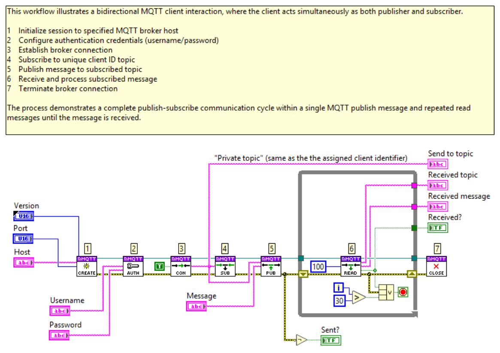
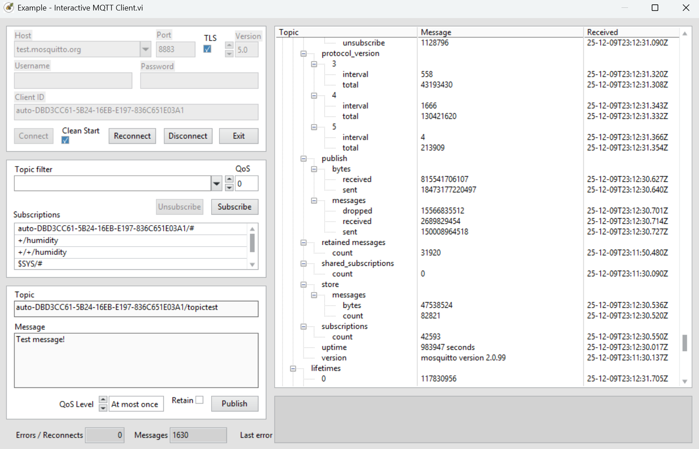

# KoRE-MQTT — LabVIEW MQTT Client Library

Native LabVIEW MQTT 3.1.1 & 5.0 — fast, dependency-free, and cross-platform.

> **Status: Beta** — The API may change between releases. Not recommended for production use without thorough testing.

## Key features 
- MQTT 3.1.1 and 5.0 support
- High throughput and low latency
- TLS/SSL support using LabVIEW native TLS
- No dependencies to other libraries, packages or frameworks
- Pure LabVIEW 
- Cross platform support (Windows, CompactRIO, NI Linux Real-Time, Linux macOS)
- Comprehensive examples

## Quick start
1. Clone the repo:
```bash
git clone https://github.com/KoRElibs/LV-KoRE-MQTT.git
```
2. Open `KoRE-MQTT.lvproj` in LabVIEW.
3. See `examples/` folder for examples. 

## Repository layout
- [FEATURES.md](FEATURES.md) — This file lists current features, normative requirements, and roadmap items. Update by commit/PR when features change.
- [LICENSE](LICENSE) — EUPL-1.2 full text
- README.md — this file
- [NOTICE.md](NOTICE.md) — short license & attribution summary
- [CONTRIBUTING.md](CONTRIBUTING.md) — contribution guidelines and required per-VI license header steps
- [VI_LICENSE_SNIPPET.txt](VI_LICENSE_SNIPPET.txt) — exact text to put into each VI Description/Icon
- `KoRE-MQTT.lvproj` - LabVIEW project
- src/ — VIs 
- example/ — example usage

## Contact / Support
File issues at: https://github.com/KoRElibs/LV-KoRE-MQTT/issues

## License
This project is licensed under the European Union Public License (EUPL) Version 1.2. See `LICENSE` for full text.

The **EUPL-1.2** is an OSI-approved copyleft license published by the European Commission.

### Key Points

- **Commercial Use Permitted**: EUPL-1.2 allows commercial use of the software. You can use, modify, and distribute the software in personal or commercial projects.

- **Unmodified Use in Proprietary Works**: You may use unmodified VIs in proprietary works without releasing your own code.

- **Copyleft on Modifications**: If you distribute a modified version of a file, that file must be released under EUPL-1.2.

- **Compatible Licences**: EUPL-1.2 is compatible with GPL v2/v3, AGPL v3, MPL v2, LGPL v2.1/v3, and others listed in the licence appendix, giving flexibility when combining with other open-source components.

Full licence text: https://joinup.ec.europa.eu/collection/eupl/eupl-text-eupl-12

## Code Example



## Usage Example


