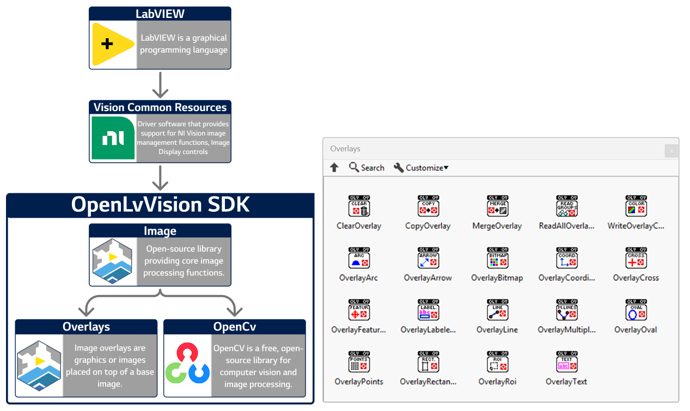

# OpenLvVision Overlays  

**OpenLvVision Overlays** provides a comprehensive suite of tools for adding non-destructive graphical overlays to your images. It allows you to seamlessly draw shapes, text, and regions of interest (ROIs) directly onto the image display without altering the underlying pixel data.

📘 **Documentation**: For a complete reference of all functions and detailed usage, visit **[openlvvision.org/docs/overlays/](https://openlvvision.org/docs/overlays/)**.

---

## 🛠 Overlay Management

Easily manage, transfer, and configure the overlay data associated with your images.

* **Lifecycle & Manipulation**: Clear existing overlays, copy overlays between image references, or merge multiple overlays together.
    * *Functions*: `ClearOverlay`, `CopyOverlay`, `MergeOverlay`.
* **Data & Attributes**: Retrieve all overlay groups from an image or configure specific overlay rendering colors.
    * *Functions*: `ReadAllOverlays`, `WriteOverlayColor`.

## 📐 Shapes & Geometry

Draw a wide variety of geometric shapes and indicators to highlight features or display measurements.

* **Basic Shapes**: Draw fundamental geometric forms onto your image display.
    * *Functions*: `OverlayArc`, `OverlayLine`, `OverlayMultipleLines`, `OverlayOval`, `OverlayRectangle`.
* **Markers & Indicators**: Place specific markers to indicate points of interest, directions, or coordinate systems.
    * *Functions*: `OverlayArrow`, `OverlayCoordinates`, `OverlayCross`, `OverlayPoints`.

## 📝 Text, Regions & Advanced

Add contextual information, custom graphics, and complex regions of interest to your vision interface.

* **Text & Labels**: Annotate your images with custom text strings or dynamic labeled indicators.
    * *Functions*: `OverlayText`, `OverlayLabeled`.
* **Regions & Features**: Visually represent complex Regions of Interest (ROIs) or specific detected machine vision features.
    * *Functions*: `OverlayRoi`, `OverlayFeature`.
* **Custom Graphics**: Insert external bitmaps directly into the overlay layer for custom branding or complex masking displays.
    * *Functions*: `OverlayBitmap`.

---

## System Requirements
* **LabVIEW**: 2020 or newer (Community Edition supported).
* **OS**: Windows operating system.
* **Dependencies**: NI Vision Common Resources (No License required).

## Installation
Install the **OpenLvVision_Overlays** package directly via [VI Package Manager (VIPM)](https://www.vipm.io/package/openlvvision_lib_openlvvision_overlays/).

## License
**OpenLvVision** is open-source software BSD-3. 

**Third Party Copyrights:**
* © 2000–2026 National Instruments Corporation. All rights reserved.
* Third-party copyrights are property of their respective owners.<>