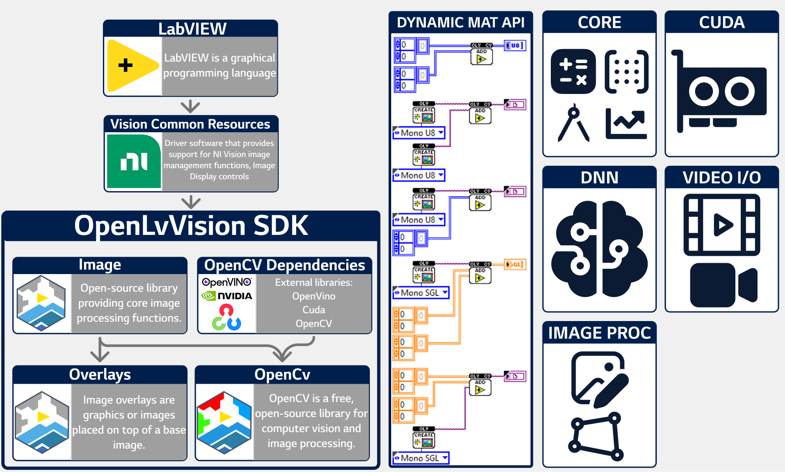

# OpenLvVision OpenCV

**OpenLvVision OpenCV** is a powerful LabVIEW wrapper for the **OpenCV** library. As an independent, community driven project (not officially affiliated with OpenCV), it brings advanced computer vision algorithms and capabilities directly into LabVIEW, utilizing efficient **Mat** handling and polymorphic VIs.

📘 **Documentation:** For a complete reference of all functions and detailed usage, visit [openlvvision.org/docs/opencv/](https://openlvvision.org/docs/opencv/)
This library is currently in active development. Additional OpenCV modules will be included in future updates.

---

## 🔌 Dynamic MAT API

The **Mat** type is reconstructed as closely as possible using malleable and polymorphic VIs. If a function can be done in OpenCV C++, there is a high chance it will also work in the LabVIEW version.

---

## 🛠️ Functionality Overview

* 🧩**Core Functions**
    * **`ArithmeticOperations`:** `AbsDiff`, `Add`, `AddWeighted`, `ConvertScaleAbs`, `Divide`, `Exp`, `Log`, `Multiply`, `Pow`, `ScaleAdd`, `Sqrt`, `Subtract`, `Sum`
    * **`BitwiseOperations`:** `BitwiseAnd`, `BitwiseNot`, `BitwiseOr`, `BitwiseXor`
    * **`ChannelManipulation`:** `ExtractChannel`, `InsertChannel`, `LUT`, `Merge`, `MixChannels`, `Split`
    * **`Comparison`:** `CheckRange`, `Compare`, `InRange`
    * **`DataConcatenation`:** `Hconcat`, `Vconcat`
    * **`FourierTransforms`:** `Dct`, `Idct`, `Dft_Real`, `Dft_Complex`, `IDft_Real`, `IDft_Complex`, `GetOptimalDftSize`, `MulSpectrums`
    * **`GeometricOperations`:** `CartToPolar`, `PolarToCart`, `Magnitude`, `Phase`
    * **`LinearAlgebra`:** `CompleteSymm`, `Determinant`, `Eigen`, `EigenNonSymmetric`, `Gemm`, `Invert`, `MulTransposed`, `Norm`, `PatchNaNs`, `SetIdentity`, `Solve`, `SolveCubic`, `SolvePoly`
    * **`MatrixImageTransformations`:** `BorderInterpolate`, `CopyMakeBorder`, `Flip`, `FlipNd`, `PerspectiveTransform`, `Repeat`, `Rotate`, `TransformTo2D`, `TransformTo3D`, `TransformTo4D`, `Transpose`
    * **`Reduction`:** `Reduce`, `ReduceArgMax`, `ReduceArgMin`, `Trace`
    * **`SimilarityMetrics`:** `BatchDistance`, `Mahalanobis`, `PSNR`
    * **`Sort`:** `Sort`, `SortIdx`
    * **`Statistical`:** `CountNonZero`, `FindNonZero`, `HasNonZero`, `Max`, `Min`, `Mean`, `MeanStdDev`, `MinMaxIdx`, `MinMaxLoc`, `Normalize`
    * **`LDA` (Class & Funcs):**
        * `Create`, `Compute`, `Load/Save`, `Reconstruct`, `Project`, `SubspaceProject`, `SubspaceReconstruct`
    * **`PCA` (Class & Funcs):**
        * `Create`, `Compute`, `Read/Write`, `Project`, `BackProject`, `PCACompute`, `PCABackProject`, `PCAProject`
    * **`SVD` (Class & Funcs):**
        * `Create`, `Decompose`, `BackSubst`, `Read`, `SVBackSubst`, `SVDecomp`, `SVD_Compute`, `SVD_SolveZ`
    * **`RNG` (Class & Funcs):**
        * `Create`, `Fill`, `Gaussian`, `Next`, `Read/Write State`, `Uniform` (Int/Float/Double), `Randn`, `RandShuffle`, `Randu`, `WriteRngSeed`

* 🧠**Deep Neural Network (DNN)**
    * **`Environment`:** `NmsBoxes`, `NmsBoxesRotated`, `GetAvailableBackends`, `GetAvailableTargets` *(x64 includes OpenVINO & CUDA backends)*
    * **`Net` (Class):**
        * `Create`, `ReadNet`, `Forward`, `SetInput`, `DumpToFile`, `DumpToPbtxt`
        * **Configure:** `Connect`, `Backend/Target`, `Fusion`, `Winograd`, `Halide`, `Shapes/Names`, `Outputs`
        * **Layers:** `Id`, `Names`, `Count`, `Types`, `Shapes`, `Unconnected`
        * **Performance:** `FLOPS`, `Memory`, `PerfProfile`
    * **`Blob` (Class):**
        * `Create`, `BlobFromImage`, `BlobFromImages`, `ReadInfo`, `ReadData`

* 🖼️**Image Processing**
    * **`ImageFiltering`:** `Bilateralfilter`, `Blur`, `BoxFilter`, `Filter2d`, `GaussianBlur`, `GetDerivKernels`, `GetGaborKernel`, `GetGaussianKernel`, `Laplacian`, `MedianBlur`, `Dilate`, `Erode`, `GetStructuringElement`, `MorphologyDefaultBorderValue`, `MorphologyEx`, `PyrDown`, `PyrMeanShiftFiltering`, `PyrUp`, `Scharr`, `SepFilter2D`, `Sobel`, `SpatialGradient`, `SqrBoxFilter`
    * **`GeometricImageTransformations`:** `GetAffineTransform` , `GetPerspectiveTransform` , `GetRectSubPix` ,`GetRotationMatrix2D` ,`InvertAffineTransform` , `Remap`,`Resize`,`WarpAffine`,`WarpPerspective`,`WarpPolar`,
    * **`ObjectDetection`:** `MatchTemplate`

* 🎥**Video I/O**
   * **`VideoCapture` (Class):**
     `Create`, `Dispose`, `Get`, `GetBackendName`, `Grab`, `IsOpened`, `OpenFile`, `OpenDevice` , `Read` , `Release` , `Retrive` , `Set`
   * **`VideoWriter` (Class):**
     `Create`, `Dispose`, `Get`, `GetBackendName`, `Open` , `Release` , `Retrive` , `Set`, `Write`

* 💻**System**
    * **`Hardware & Build`:** `CheckHardware`, `GetBuildInfos`, `GetNumThreads`, `GetVersion`, `SetNumThreads`

* 🗂**Cuda**
    * **`Device`:** `GetCudaEnabledDeviceCount`, `GetDevice`, `GetDeviceInfo`, `ResetDevice`, `SetDevice`, `TargetArchsHas`, `TargetArchsHasBin`, `TargetArchsHasPtx`,
    * **`GpuMat` (Class):**
        * `Create`, `Dispose`, `AdjustRoi`, `Clone`, `Col`, `ColRange`, `ConvertTo`, `CopyTo`, `Empty`, `LocateROI`, `ReadInfo`, `ReCreate`, `Row`, `RowRangeose`, `SetTo`, `GetPointer`, `ReadElemSize`, `ReadStep`, `ReleasePointer`, `Reshape`, `Swap`
    * **`HostMem` (Class):**    
        * `Create`, `Dispose`, `CopyFormData`, `CopyToImage`, `CopyToArray`, `Clone`, `CreateGpuMatHeader`, `Empty`, `ReadInfo`, `GetPointer`, `ReadElemSize`, `ReadtStep`, `ReleasePointer`, `Reshape`, `Swap`
    * **`Stream` (Class):**
        * `Create`, `Dispose`,`QueryIfComplete`,`WaitEvent`,`WaitForCompletion`
    * **`Event` (Class):**
        * `Create`, `Dispose`,`ElapsedTime`,`QueryIfComplete`,`Record`,`WaitForCompletion`
            

---

## 📥 Installation

1.  **Online:** Install the **OpenLvVision** package directly via [VI Package Manager (VIPM)](https://www.vipm.io/publisher/openlvvision/).
2.  **Offline:** For offline installation, visit the [Installation Guide](https://openlvvision.org/docs/installation/openlvvision/).

### 🖥️ System Requirements
* **LabVIEW:** 2020 or newer (including the Community Edition)
* **OS:** Windows operating system
* **Dependencies:** Vision Common Resources (license free)