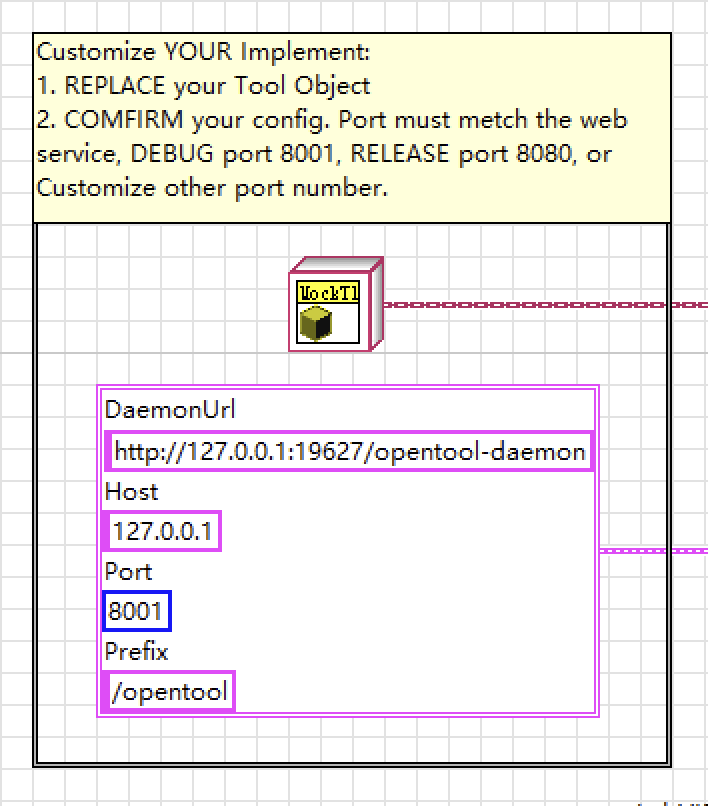

# OpenTool SDK for LabVIEW

[English](README.md) · 中文

OpenTool的LabVIEW SDK，用于LabVIEW应用程序中实现OpenTool Server。

## 功能

- 封装了遵循[OpenTool Spec](https://github.com/opentool-hub/opentool-spec)的Web Service
    - LabVIEW默认的HTTP端口，Debug为`8001`，Release为`8080`
    - 若需修改默认端口，请修改NI的WebServer配置文件，Windows路径通常在：`C:\Program Files (x86)\National Instruments\Shared\NI WebServer\NIWebAppServer.ini.defaults`
    ```
    [Default]
    Port = 8080
    ```
- 需要开发者实现ITool接口，并设置到WebService的`Startup.vi`中

## 使用

1. 创建Tool的实现类，例如`MockTool.lvclass`实现`ITool`接口
    - Init.vi: 用于初始化你的工具
    - Call.vi: 用于处理OpenTool的用具调用，并返回执行结果
    - Load.vi: 用于返回工具的描述，需要遵循OpenSpec的JSON格式描述，例如：`/Example/clac_tool.json`
    - Close.vi: 用于处理WebService关闭时的清理工作 
    - Tool的实现例子可见：`/Example/MockTool.lvclass`
2. 修改`Startup.vi`，将Tool的实现类添加到WebService中，如图：
   
- 验证效果：拉起WebService后，运行`/Example/Main.vi`（注意配置端口与WebService一致）